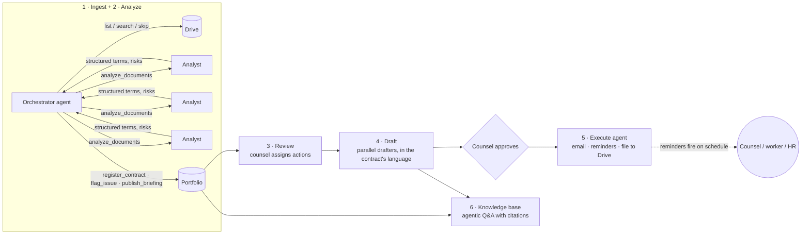

# Handover

**The handover you never got.** Handover is an agentic contract desk for new in-house counsel. On day one it
finds every employment contract in the company's Drive, reads each one (scanned, typed or in another
language), reconciles amendments, and shows counsel which deadlines they can't miss. Then it drafts the
addenda and termination letters, sends them, chases signatures and files the finals, pausing for counsel's
approval before anything leaves the building.

It runs one workflow end to end: **Ingest → Analyze → Review → Draft → Execute → Know**. Every step is an
agent run you can watch live, and counsel approves at each gate.

---

## Why agentic, not bulk analysis

A bulk analyzer takes a folder of PDFs and returns a spreadsheet. Handover's orchestrator **decides what to
do next** at every step:

| Situation in the demo Drive | What the agent does |
|---|---|
| A German contract filed as `Scans/scan_0042.pdf`, image-only, invisible to search | Notices search can't see inside scans and sends it to an analyst anyway |
| Maya Chen's original agreement "expired" in July | Reads her Amendment No. 1, which moves the end date, and **reconciles both** into one contract with the new deadline |
| Arjun Sharma's 30-day non-renewal window closed 4 days ago | Flags it as missed and explains the fallback: the 60-day termination-for-convenience clause |
| Lukas Becker's fixed term has used the full 2-year maximum under German law (§ 14(2) TzBfG) | Recommends converting him to permanent, citing the board minutes' hiring-freeze exemption for critical engineers |
| A California non-compete in Emily Johnson's contract | Flags it as void (§ 16600) and recommends an amendment plus the § 16600.1 notice |
| Invoices, a vendor NDA, an office lease | Sets them aside with reasons, but still flags the lease's renewal deadline as out of scope yet important |
| Counsel approves a German addendum | The execution agent emails a courtesy copy **and** schedules a wet-ink hand-delivery reminder, because § 623 BGB requires written form |

## The workflow



1. **Ingest**: the orchestrator explores the Drive (Google Drive or the bundled demo Drive), lists folders,
   runs full-text search, and decides what's relevant.
2. **Analyze**: analyst sub-agents read documents **in parallel**. Claude reads each PDF natively (text layer
   plus page images), so scans and Japanese, German, Spanish and French contracts need no OCR pipeline.
   Output is constrained to a JSON schema (structured outputs).
3. **Review**: a portfolio dashboard with a deadline radar, risks, recommendations and the agent's handover
   memo. Counsel assigns an action per contract (renew, non-renew, terminate, amend, make permanent, confirm
   probation).
4. **Draft**: parallel drafters write each document in the original contract's language, grounded in the
   original PDF, with compliance notes and a delivery plan. Output is PDF and DOCX, editable in the app.
5. **Execute**: after approval, an agent emails documents (sandbox by default), schedules signature,
   delivery and deadline reminders, and files finals to Drive. A deadline guard emails counsel 14 and 3 days
   before every action deadline from the moment a contract is registered.
6. **Know**: every clause (original and English), contract, draft and memo is indexed (SQLite FTS5). A
   knowledge agent answers questions and cites contracts as `[C-003]`, linking to the record.

## Quick start

Requirements: [uv](https://docs.astral.sh/uv/) and Node.js 20+.

```bash
./start.sh             # macOS / Linux
```

```powershell
.\start.ps1            # Windows PowerShell
```

Open **http://localhost:8000** and press **Start discovery**.

Without an API key, everything runs in **Simulation mode**: the real tools, database, drafts, outbox,
reminders and filings, driven by a scripted brain over the demo corpus. Use it for rehearsals and offline
demos. For live agents, put **one** key in `.env`:

```
ANTHROPIC_API_KEY=sk-ant-...     # Claude (Opus 5.5)
GROQ_API_KEY=gsk_...             # or Groq: free key at https://console.groq.com/keys (most free headroom)
GEMINI_API_KEY=...               # or Gemini: free key at https://aistudio.google.com/apikey
```

The key is picked up on the next run; no restart needed. With both set, `LLM_PROVIDER` chooses
(`auto` prefers Claude). Free-tier Gemini keys are rate-limited and can be slow at busy times (minutes
per call). Handover backs off on rate limits (429) and switches to another Flash model when one is overloaded
(503/504); `ANALYST_CONCURRENCY=4` stays within free-tier limits.

Development mode (API auto-reload + Vite on :5173): `./start.sh --dev` or `.\start.ps1 -Dev`.

> **Windows:** keep the project in a short path (e.g. `C:\dev\handover`). Very long paths can break
> Pillow's font DLL inside `.venv` ("filename or extension is too long").

## A 3-minute demo script

1. **Mission control → Start discovery.** Narrate the live feed: folders open, search misses the scan, three
   files set aside, then *"Reading 12 documents in parallel"*, with the German and Japanese scans showing as
   *image-only scan*. The memo appears with clickable citations.
2. **Portfolio.** Read the deadline radar: Arjun *missed*, Daniel in 6 days, Priya in 11. Open
   **Lukas Becker**: German clauses with an English toggle, the TzBfG risk, and the "Make permanent" AI pick.
   Assign actions: Daniel → Renew, Arjun → Terminate, Lukas → Make permanent, Priya → Confirm probation,
   Emily → Amend ("Delete Section 4 Non-Competition").
3. **Draft documents.** Five drafters run in parallel. Open Lukas's addendum (in German, live mode): the
   compliance tab cites § 623 BGB, and the delivery plan says email plus wet-ink.
4. **Approve all → Execute.** Watch emails go to the sandbox outbox, reminders get scheduled, and finals
   get filed under `Legal/Employment/<country>/<name>`. Press **+7 days** to fast-forward: signature
   chasers and the hand-delivery reminder fire.
5. **Ask the archive:** *"Who has a non-compete, and is it enforceable?"*

## Configuration (`.env`)

| Variable | Default | Meaning |
|---|---|---|
| `ANTHROPIC_API_KEY` | empty | Live mode on Claude |
| `GROQ_API_KEY` | empty | Live mode on Groq (free tier) |
| `GEMINI_API_KEY` | empty | Live mode on Gemini (also reads `GOOGLE_API_KEY`) |
| `LLM_PROVIDER` | `auto` | `auto` (first key found: Claude, Groq, Gemini) · `anthropic` · `groq` · `gemini` · `openai_compat` |
| `GROQ_AGENT_MODEL`, `GROQ_ANALYST_MODELS`, `GROQ_VISION_MODEL` | `qwen/qwen3.8-27b`, `openai/gpt-oss-120b,openai/gpt-oss-20b`, `qwen/qwen3.8-27b` | Orchestrator, document analysts (round-robin), scanned-page reader |
| `GROQ_TPM` | `8000` | Tokens per minute per model; requests are paced and trimmed to fit |
| `OPENAI_COMPAT_*` | empty | Any other OpenAI-compatible endpoint (OpenRouter, Cerebras, local Ollama): `BASE_URL`, `API_KEY`, `MODEL`, `VISION_MODEL` |
| `HANDOVER_MODE` | `auto` | `auto` (live if a key is set) · `simulate` |
| `HANDOVER_MODEL` | `claude-opus-5-5` | Claude model for all agents |
| `HANDOVER_EFFORT` | `medium` | Claude effort, `low`…`max` (Opus 5.5 defaults to medium) |
| `GEMINI_MODEL` | `auto` | Best Flash model your key can use, or pin one (e.g. `gemini-3.5-flash`) |
| `ANALYST_CONCURRENCY` | `4` | Parallel document analysts |
| `COMPANY_NAME`, `COUNSEL_NAME`, `COUNSEL_EMAIL`, `HR_EMAIL` | Aster Robotics demo | Used in drafts, emails and the allowlist |
| `HANDOVER_TODAY` | real date | Pin "today" for repeatable demos |
| `DRIVE_SOURCE` | `local` | `local` demo Drive or `google` |
| `MAIL_TRANSPORT` | `sandbox` | `sandbox` (no email leaves) or `smtp` |
| `SMTP_*`, `MAIL_REDIRECT_ALL_TO` | empty | Real delivery; redirect every email to one inbox for demos |

The demo corpus is dated relative to the day you generate it. To refresh the deadlines:
`uv run python scripts/generate_corpus.py` (or `--anchor 2026-11-19`).

### Google Drive

1. In Google Cloud Console, enable the **Google Drive API** and create an OAuth client of type **Web
   application** with redirect URI `http://localhost:8000/api/drive/google/callback`.
2. Save the downloaded JSON as `credentials/google_oauth_client.json`.
3. Open **Settings → Connect Google Drive**. Discovery uses `drive.readonly`; filing uses `drive.file`, so
   Handover can only write files it created. Set `GOOGLE_DRIVE_ROOT_FOLDER_ID` to scope it to one folder.

## How it uses Claude

- **Model:** Claude Opus 5.5 (`claude-opus-5-5`) with adaptive thinking and explicit `effort`.
- **Orchestrators** (discovery, execution, knowledge) run a streaming tool-use loop
  (`client.beta.messages.stream`). The loop appends every assistant turn unmodified, thinking blocks
  included, and never edits history, so preserved thinking and prompt caching keep working. Tool calls in
  one turn run concurrently.
- **Progress you can watch:** `thinking.display: "updates"` (beta `thinking-display-updates-2026-08-18`)
  streams the agent's between-tool progress notes into the activity feed.
- **Safety net:** server-side refusal fallbacks (`fallbacks: "default"`, beta
  `server-side-fallback-2026-07-01`). Refusals and truncated tool calls are handled explicitly.
- **Eager tool-input streaming** on every tool, with client-side validation: a malformed tool input goes
  back to the model as an `is_error` result rather than being executed.
- **Analysts and drafters** are single structured-output calls (`output_config.format` with a JSON schema)
  that read the original document as a PDF `document` block.
- **Prompt caching** via top-level `cache_control`. Run cost is tracked per run and shown in the feed.

Rough cost for a live discovery over the 15-file demo Drive on Opus 5.5 is on the order of $1–3. It varies
with effort and document length; the activity feed shows the actual figure.

### Groq (free tier) and other OpenAI-compatible providers

`handover/agents/openai_compat.py` runs the same agents over the Chat Completions API. Groq is the
default target, and the free tier's ~8K tokens per minute per model shape the design:

- **Model per role.** `qwen/qwen3.8-27b` orchestrates (parallel tool calls). Document analysis
  alternates between `openai/gpt-oss-120b` and `gpt-oss-20b` with strict JSON-schema output, so each
  model's per-minute budget adds up. Scanned pages are transcribed one page per request by Qwen's
  vision, then analysed as text.
- **Paced, not throttled.** A client-side token budget per model waits for room in the minute window
  instead of tripping 429s, and honours `retry-after` when one happens anyway.
- **Small requests.** Old tool results are trimmed as a run grows, and the orchestrator sees lean
  per-document summaries, so every request stays under the per-minute cap.
- **Reasoning as progress notes.** Groq's parsed reasoning (`reasoning_format: parsed` for Qwen,
  `message.reasoning` for gpt-oss) feeds the activity feed.

Point `OPENAI_COMPAT_BASE_URL` / `OPENAI_COMPAT_MODEL` at OpenRouter, Cerebras or a local Ollama
(`http://localhost:11434/v1`) to use those instead.

### Gemini instead

The same agents run on Gemini through `handover/agents/gemini.py`, using the Google Gen AI SDK
(`google-genai`). The orchestrator loop, tools, guardrails and UI are unchanged; only the model calls
differ:

- Tools are declared as JSON Schema (`parameters_json_schema`), with automatic function calling turned off
  so Handover runs every tool itself, inside its guardrails.
- Each model turn is appended unmodified so Gemini's thought signatures survive between tool calls.
  Thought summaries (`include_thoughts`) become the progress notes in the activity feed.
- Analysts and drafters use `response_json_schema` with the same schemas as the Claude path. PDFs (scans
  included) go in as inline parts.
- `GEMINI_MODEL=auto` lists the models your key can use and picks the best Flash model. Rate-limited
  calls (HTTP 429/5xx) are retried with backoff. The feed shows token counts instead of a dollar cost.

## Guardrails

- Nothing is sent until counsel approves a draft. Editing a draft sends it back for re-approval.
- The execution agent's tools allow email only to addresses on file (the worker, HR, counsel). They refuse
  unapproved drafts and won't schedule reminders in the past. These rules are enforced in code, not prompts.
- Email defaults to a sandbox (`data/outbox/*.eml`). Real SMTP is opt-in and can be redirected to a single
  test inbox.
- The deadline guard schedules counsel alerts independently of the LLM.

## Project layout

```
handover/                 FastAPI app + agents (Python)
  main.py                 REST API, SSE event stream, static dashboard
  agents/runtime.py       run lifecycle, streaming tool-use loop (Claude), structured calls, cost tracking
  agents/gemini.py        the same loop and structured calls on Gemini
  agents/openai_compat.py Groq and other OpenAI-compatible providers
  agents/discovery.py     stages 1–3: Drive tools, parallel analysis, reconciliation, briefing
  agents/analyst.py       per-document analyst sub-agent (PDF → structured terms)
  agents/drafting.py      stage 4: parallel drafters → PDF + DOCX
  agents/execution.py     stage 5: email / reminders / filing tools with guardrails
  agents/knowledge.py     stage 6: knowledge-base agent with citations
  agents/simulator.py     offline "brain" that drives the same tools
  connectors/drive.py     demo Drive + Google Drive (OAuth)
  connectors/mail.py      sandbox outbox + SMTP
  scheduler.py            reminder engine (and demo fast-forward)
frontend/                 React + Vite + Tailwind dashboard
scripts/generate_corpus.py  builds the demo Drive (typed + scanned PDFs, DOCX, 5 languages)
sample_data/              demo Drive + ground truth for simulation mode
data/                     runtime state (SQLite, drafts, outbox, filings) – gitignored
```

## Not built yet

E-signature (DocuSign/Dropbox Sign) to close the loop on signatures, Gmail/Outlook APIs instead of SMTP,
inbound reply tracking, multi-user auth and roles, and semantic (embedding) search next to FTS5.

*Demo documents, people and companies are fictional. Handover's analysis is decision support for qualified
counsel, not legal advice.*
